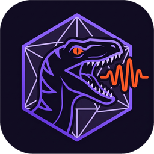

<p align="center"></p>

# DynaMusic

Reproductor de música y ambientación para sesiones de rol de mesa. Cada **escena** tiene cuatro moods (PAUSED, NORMAL, RAGED, ADVANTAGE) con su track, un fondo de imagen o video y un **aura** visual que reacciona a la música. Durante la partida cambiás de mood con el teclado y todo acompaña el momento.

Proyecto personal, sin fines comerciales.


## Qué hace

- **Escenas** con un track por mood, fondo (imagen o video) y un aura por mood.
- **Aura reactiva** que sigue el bombo, el redoblante y la melodía, sin tapar el centro de la pantalla.
- **Ventana de ambiance** para mostrar en otro monitor.
- **Play now y playlists** para tocar cualquier track fuera de los moods.
- **YouTube**: buscar y bajar audio desde la app.

## Instalar

Bajá `DynaMusic-Setup-X.Y.Z.exe` desde [Releases](https://github.com/MarianoCarrizo/DynaMusic/releases) y seguí el instalador. Trae todo lo necesario (Java y ffmpeg), no pide administrador y se actualiza solo: cuando hay una versión nueva aparece un aviso para instalarla ahora o al cerrar.

Opcional: **Node.js** o **Deno** mejoran la descarga desde YouTube.

## Cómo se usa

| Acción | Cómo |
|---|---|
| Cargar música | **Open Folder** |
| Asignar un track a un mood | Arrastrarlo a la tarjeta, o clic derecho → **Assign to** |
| Cambiar de mood | Teclas **1 / 2 / 3 / 4** o clic en la tarjeta |
| Escuchar sin asignar | Doble clic en la biblioteca |
| Reproducir on demand | Clic derecho → **Play now**, o **Enter** |
| YouTube | Pegar una URL y **Add** o **Play**; **Browse** para buscar |
| Escenas | **+** para crear, **Save as** para duplicar, **Edit scene** para auras y fondo |
| Sacar el fondo | **Edit scene** → **Background** → **Remove** |
| Ajustar el aura en vivo | Franja **Live aura** |
| Ventana de ambiance | **Show/Hide ambiance**; la flecha elige el monitor |

## Formatos de audio

**Soportados:** MP3, WAV, FLAC, AIFF, M4A, AAC, OGG, Opus, WMA y APE. Aparecen en la biblioteca, se pueden arrastrar y abrir con DynaMusic desde el Explorador.

**Necesitan ffmpeg:** OGG, Opus, AAC, WMA, APE, los M4A con ALAC y los WAV, AIFF o FLAC de más de 96 kHz (se remuestrean a 96 kHz). El instalador incluye ffmpeg. Sin ffmpeg esos archivos siguen en la lista, atenuados, y al reproducirlos se explica el motivo; MP3, WAV, AIFF, M4A (AAC) y FLAC funcionan igual.

**Calidad:** los 24 bits se conservan, sin dither ni recorte a 16 bits. Bajo el título se ve el formato, la profundidad, la frecuencia y el bitrate del archivo original, y se resalta cuando es alta resolución (más de 16 bits o más de 48 kHz).

**Caché:** los FLAC y los formatos que pasan por ffmpeg se convierten una sola vez a WAV en `%APPDATA%\DynaMusic\cache\audio`. La segunda reproducción es inmediata y la pista siguiente de una playlist se prepara por adelantado. El tamaño máximo va de 512 MB a 20 GB (2 GB por defecto) y se cambia con el engranaje de la cabecera de la ventana, que también muestra el espacio usado y permite vaciar la caché. Cuando se llena se borra primero lo que hace más tiempo que no se usa.

**Tags:** el título, el artista, el álbum y la carátula embebida se leen de FLAC, MP3, OGG, Opus y M4A. Lo que se baja de YouTube se guarda como MP3.

Tus escenas y descargas se guardan en `%APPDATA%\DynaMusic` y no se borran al actualizar ni desinstalar.

## Correr desde el código

Con JDK 25 y ffmpeg en el PATH:

```bash
./mvnw javafx:run
```

## Estado del proyecto

El código está en un refactor gradual, módulo por módulo, para mejorar su estructura y legibilidad. El plan y el avance están en [#28](https://github.com/MarianoCarrizo/DynaMusic/issues/28).

## Aviso sobre YouTube

La descarga de audio de YouTube es para uso personal. Respetar los derechos de autor y los términos de servicio de YouTube es responsabilidad de quien usa la app.

## Apoyar el proyecto

DynaMusic es gratis y open source. Si te sirve en tus partidas, podés invitarme un cafecito:

[](https://cafecito.app/duhonha)

## Licencia

[Apache 2.0](LICENSE)
